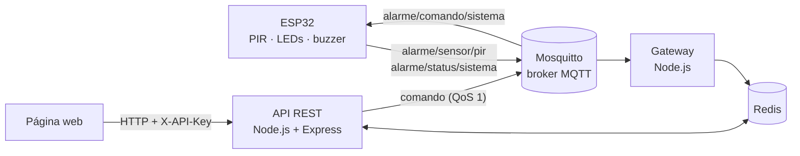

# Sensor de Alarme com Detector de Movimento (PIR)

Projeto da disciplina de Internet das Coisas (IFMG – Campus Ouro Branco, Sistemas de Informação).

Um ESP32 com sensor PIR, dois LEDs e um buzzer funciona como um alarme que pode ser armado e desarmado pela internet. A telemetria do sensor chega a uma página web, e os comandos feitos na página só mudam o estado exibido depois de o ESP32 confirmá-los.

## Arquitetura



**Telemetria:** ESP32 → MQTT → gateway → Redis → API → página.
**Comando:** página → API → Redis (`pending`) e MQTT → ESP32 → confirmação MQTT → gateway → Redis (`confirmed`) → página.

## Estrutura do projeto

```
esp32/esp32_buzzer/   firmware do ESP32 (esp32_buzzer.ino, secrets.h.example)
gateway/              assina o MQTT, valida e grava no Redis (index.js, comando.js, consulta.js)
api/                  API REST e página web (server.js, public/index.html)
mosquitto/            docker-compose.yml (Mosquitto + Redis) e configuração do broker
entregas/             documentos das entregas da disciplina
```

As outras pastas dentro de `esp32/` são os programas de teste das entregas anteriores.

## Hardware

| Componente | Pino do ESP32 |
|---|---|
| Sensor PIR HC-SR501 (saída) | GPIO 13 |
| LED verde | GPIO 12 |
| LED vermelho | GPIO 14 |
| Buzzer ativo | GPIO 27 |

O HC-SR501 deve ser alimentado com 5 V (pino VIN do ESP32).

## Como executar

Requisitos: Docker, Node.js 20.12 ou mais novo e Arduino IDE com a biblioteca PubSubClient.

**1. Broker e Redis**
```bash
cd mosquitto
docker compose up -d
```

**2. Gateway**
```bash
cd gateway
npm install
cp .env.example .env      # no Windows: copy .env.example .env
node index.js
```

**3. API e página web**
```bash
cd api
npm install
cp .env.example .env
node server.js
```
Abra http://localhost:3000.

**4. ESP32**
1. Em `esp32/esp32_buzzer/`, copie `secrets.h.example` para `secrets.h` e preencha a senha do Wi-Fi (e o IP do computador que roda o broker em `MQTT_SERVER`).
2. Abra `esp32_buzzer.ino` na Arduino IDE e faça o upload.
3. O ESP32 calibra o PIR por 30 s, conecta ao broker e avisa que está desarmado.

## Configuração

| Arquivo | Variáveis |
|---|---|
| `api/.env` | `PORT`, `REDIS_URL`, `BROKER_URL`, `MQTT_USER`, `MQTT_PASS`, `API_KEY` (mínimo de 8 caracteres), `LIMITE_PRESENCA_SEGUNDOS` |
| `gateway/.env` | `REDIS_URL`, `BROKER_URL`, `MQTT_USER`, `MQTT_PASS` |
| `esp32/esp32_buzzer/secrets.h` | `WIFI_SSID`, `WIFI_PASSWORD`, `MQTT_SERVER`, `MQTT_PORT`, `MQTT_USER`, `MQTT_PASS` |

Os arquivos `.env` e `secrets.h` **não** são versionados (ver `.gitignore`). Os `.example` trazem valores de exemplo para uso acadêmico: troque a `API_KEY` em qualquer uso real.

## API

| Método e rota | Descrição |
|---|---|
| `GET /api/health` | situação da API, do Redis e do broker |
| `GET /api/devices/:id/state` | último estado do sensor |
| `GET /api/devices/:id/history?limit=` | histórico de leituras (1 a 100) |
| `GET /api/devices/:id/presence` | online ou offline e último contato |
| `GET /api/devices/:id/actuator` | estado do atuador (solicitado, confirmado, status) |
| `POST /api/devices/:id/command` | envia `{"command":"ON"}` ou `{"command":"OFF"}` (exige o cabeçalho `X-API-Key`) |

Códigos de resposta do comando: `202` aceito, `400` comando ou JSON inválido, `401` sem chave, `403` chave inválida, `503` Redis ou broker indisponível.

Exemplo (PowerShell):
```powershell
curl.exe -i -X POST http://localhost:3000/api/devices/esp32-alarme-01/command -H "X-API-Key: SUA_CHAVE" -H "Content-Type: application/json" -d '{\"command\":\"ON\"}'
```

## Tópicos MQTT

| Tópico | Sentido | Conteúdo |
|---|---|---|
| `alarme/sensor/pir` | ESP32 → broker | telemetria (`deviceId`, `sensorPIR`, `timestamp`) |
| `alarme/comando/sistema` | API → ESP32 | `{"requestId":"...","command":"ON"}` ou `"OFF"` (QoS 1) |
| `alarme/status/sistema` | ESP32 → broker | confirmação (`deviceId`, `requestId`, `sistemaAtivo`, `timestamp`) |

## Segurança e tratamento de falhas

- Credenciais em `.env` e `secrets.h`, fora do Git.
- Comandos exigem `X-API-Key` (comparação com `timingSafeEqual`); a API não inicia sem a chave.
- Só `ON` e `OFF` são aceitos; o gateway valida os campos de cada mensagem.
- Redis fora do ar: a API responde `503` e a página avisa; volta sozinha.
- Broker fora do ar: gateway e API reconectam automaticamente.
- Wi-Fi do ESP32 cai: ele tenta reconectar a cada 5 s.
- ESP32 reinicia: sempre liga desarmado e avisa o gateway (`requestId: "boot"`), que ajusta o estado no Redis.

## Testes

Foram executados 8 testes: fluxo normal, chave vazia ou inválida (página), Redis fora do ar, broker fora do ar, queda do Wi-Fi do ESP32, reinício do ESP32 e chave inválida pela API. As evidências estão no PDF da Entrega 9, na pasta `entregas`.

## Limitações conhecidas

- O Mosquitto aceita conexões anônimas (`allow_anonymous true`); o código já aceita `MQTT_USER` e `MQTT_PASS`.
- A presença só é atualizada quando chega telemetria (mudança de estado do PIR), então o dispositivo pode aparecer offline após muito tempo sem movimento.
- Se o gateway estiver desligado quando o ESP32 confirma um comando, a confirmação se perde.
- HTTP e MQTT sem criptografia, adequados a uma rede local de laboratório.

## Autor

Eduardo Octavio de Paula Souza – Sistemas de Informação, IFMG Campus Ouro Branco.
